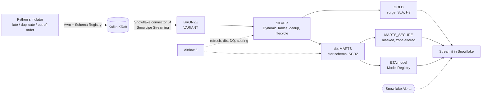

# Real-Time Food Delivery Analytics Platform (Pune)

An end-to-end data platform for a Swiggy/Zomato-style marketplace, simulated in Pune.
Events stream from a Python simulator through Kafka into Snowflake. There they become
near-real-time SLA and surge signals (Dynamic Tables), a tested star schema (dbt), an ETA
model served from the Snowflake Model Registry, governed dashboards (Streamlit in Snowflake),
and an orchestrated, monitored pipeline (Airflow, data quality, Snowflake Alerts).



## Results (all verified against ground truth)

| Area | Result |
|---|---|
| Ingestion | Kafka → BRONZE: every message landed (offset gaps = 0 on all partitions); producer → Snowflake **p50 0.21 s** |
| Real-time layer | SILVER/GOLD Dynamic Tables reconciled **37/37** against the simulator's own numbers; duplicates removed = duplicates injected |
| Historical layer | dbt star schema: **81 nodes green**; marts reconciled **35/35** (GMV ₹103,034,543 to the paisa, cohorts, retention) |
| ETA model | XGBoost served in-warehouse: **MAE 4.29 min vs 6.45** for the current promise (−33%); in-warehouse MAE = offline MAE |
| Operations | Airflow DAG skips the warehouse when there's no new data; injected bad data fails the run and fires an alert |
| Governance | PII masked and rows filtered by zone per role: **6/6** role checks, still 6/6 after a full rebuild |
| Cost | **≈1 credit** for everything above ([cost report](docs/cost_report.md)) |

**Stack:**
- **Ingest and storage:** Python, Kafka (KRaft) + Schema Registry + Kafka Connect, Snowflake (Snowpipe Streaming, Dynamic Tables)
- **Transform and ML:** dbt Core, Snowpark ML + Model Registry, XGBoost
- **Orchestration and apps:** Airflow 3 (Astro), Streamlit in Snowflake
- **Infra and CI:** Terraform, GitHub Actions, Docker

**Docs:** [architecture](docs/architecture.md) · [design decisions (ADRs)](docs/decisions/) ·
[interview Q&A](docs/interview_qa.md) · [resume bullets](docs/resume_bullets.md) · [cost report](docs/cost_report.md)

| Phase | | |
|---|---|---|
| P1 | ✅ | Simulator with late / duplicate / out-of-order events and a ground-truth manifest |
| P2 | ✅ | Kafka topics, Avro Schema Registry contract, Snowflake Kafka connector v4 → BRONZE |
| P3 | ✅ | SILVER/GOLD Dynamic Tables: dedup, order lifecycle, demand/supply + surge, SLA breaches, H3 |
| P4 | ✅ | dbt: incremental fact, event-sourced SCD2, cohorts, daily KPIs, 39+ tests |
| P5 | ✅ | Airflow 3 DAG, persisted data-quality checks, Snowflake Alerts, latency metric |
| P6 | ✅ | ETA model: leakage-safe features, Model Registry, champion/challenger, MAE tracking |
| P7 | ✅ | Governance (secure views on Standard edition), zero-copy clone + Time Travel, cost report |
| P8 | ✅ | Streamlit in Snowflake dashboard, Terraform module, GitHub Actions CI, final docs |

## Quick start

Requirements: Python 3.11, GNU make (Windows: `winget install ezwinports.make`), Docker Desktop, Astro CLI 1.45 (`winget install Astronomer.Astro --version 1.45.0`).

```bash
make install        # .venv + dependencies
make test           # ruff + black + sqlfluff + unit tests
make sim-sample     # 3 simulated hours of Friday dinner rush -> data/sample, then a report
make sim-backfill   # history since launch (2026-07-01) -> data/backfill/*.jsonl.gz
```

### Local streaming (no Snowflake needed)

```bash
cp .env.example .env
make up                 # Kafka, Schema Registry, Kafka Connect, kafka-ui (http://localhost:8080)
make schemas-register   # 11 Avro subjects, BACKWARD compatibility
make sim SINK=kafka SPEED=60 DURATION=60
make topics             # messages per topic-partition
make test-integration   # topics, contract gate, Avro round trip, connector plugin
make stop               # always stop when done
```

### Snowflake ingestion (one-time setup, then per session)

```bash
make sf-keygen          # key pairs in secrets/ (gitignored); prints the ALTER USER + .env lines
#  -> run the printed ALTER USER in Snowsight, fill .env (account, user, keys)
make sf-setup           # 01_setup, 02_rbac, 03_bronze: DB, schemas, warehouses, monitors, roles, BRONZE
make up                 # restart so Connect picks up the Snowflake settings from .env
make connector-up       # starts Snowpipe Streaming ingestion (billed per GB)
make sim SINK=kafka SPEED=60 DURATION=120
make connector-status   # RUNNING, 3 tasks
make sf-verify          # row counts, offset gaps, latency, sample row
make load-backfill      # optional: ~100 days of history into BRONZE via stage + COPY
make stop               # delete connector, stop containers, suspend Dynamic Tables + warehouses
```

### Real-time layer: Dynamic Tables (P3)

```bash
make sf-dt              # create SILVER + GOLD Dynamic Tables (INCREMENTAL, GOLD lag 10 min)
make dt-status          # ACTIVE / SUSPENDED, refresh mode, lag
make sf-reset-bronze    # DEV only: empty BRONZE before a reconciliation run
make reconcile          # seeded run -> Kafka -> BRONZE -> SILVER/GOLD vs Python ground truth (37 metrics)
make sf-verify-dt       # data-quality checks (all 0), headline KPIs, top surge buckets, orders at risk
make dt-demo            # GOLD lag 1 minute for a live demo (remember: make dt-normal)
```

### Historical layer: dbt (P4)

```bash
make sim-backfill && make sf-reset-bronze && make load-backfill   # ~100 days of history into BRONZE
make dt-resume && make dt-refresh                                  # SILVER over the full history (~20 s)
make dbt                # dbt build: seeds, models, snapshot, 39 tests (ARGS="--full-refresh" after a backfill)
make reconcile-marts    # 35 metrics: MARTS vs Python ground truth from data/backfill
make dbt-docs && make dbt-docs-serve   # lineage + column docs on http://localhost:8001
```

### Orchestration, data quality, alerts (P5)

```bash
make sf-keygen && make sf-setup && make sf-ops && make alerts-setup   # SVC_AIRFLOW, OPS, Alerts (suspended)
make airflow-test       # DAG integrity tests inside the Astro image
make airflow-up         # Airflow on http://localhost:8082 (airflow/.env holds only SVC_AIRFLOW's connection)
make airflow-trigger    # one fooddel_pipeline run (skips if BRONZE has no new rows)
#   force a run:  cd airflow && astro dev run dags trigger fooddel_pipeline --conf '{"force": true}'
make alerts-resume      # demos only (serverless, every 10 min); make stop suspends them
make stop               # also stops Airflow and suspends Alerts
```

### ETA model (P6)

```bash
make dbt ARGS="--select ml_eta_features+"   # feature table + tests (incl. leakage guard)
make ml-setup           # ML.MODEL_VERSIONS, ETA_PREDICTIONS, V_ETA_ACCURACY_DAILY, ALERT_ETA_DRIFT (suspended)
make ml-train           # train, compare with 3 baselines, log to Model Registry, promote only if better
make ml-backtest        # score TEST in-warehouse; MAE must equal the offline result
make ml-score           # score LIVE orders (the DAG's score_eta task does this every run)
```

### Governance + cost (P7)

```bash
make sf-governance      # roles (PII_READER, OPS_WEST/EAST), zone mapping, revoke direct MARTS access
make dbt                # builds MARTS_SECURE secure views (PII masked, zones filtered) + grants
make governance-check   # role x view matrix: masking, zones, no direct MARTS access -> PASS/FAIL
make qa-clone           # zero-copy clone + Time Travel restore demo; make qa-drop afterwards
make cost-report        # docs/cost_report.md from ACCOUNT_USAGE
```

### Dashboards, infra as code, CI (P8)

```bash
make streamlit-smoke    # every dashboard query, run as FOODDEL_BI (governed access)
make streamlit-deploy   # APPS.FOODDEL_DASHBOARD: Snowsight > Projects > Streamlit
make tf-validate        # Terraform module (env -> DB, schemas, XSMALL warehouses + monitors, roles); nothing applied
# CI: .github/workflows/ci.yml runs make install + make test and terraform fmt/validate on every push
```

## The simulator

- **Entities:**
  - 12 Pune zones (H3 res-8 cells)
  - 300 restaurants (menus, prep times, ratings)
  - 20k customers (signups since launch, churn, heavy-tailed order frequency)
  - 400 drivers (shift templates)
- **Order lifecycle:** `PLACED → ACCEPTED → DRIVER_ASSIGNED / FOOD_READY → PICKED_UP → DELIVERED`.
  `CANCELLED` can happen any time before pickup: the restaurant rejects it, the customer
  cancels, or no driver is found within 10 minutes.
- **Patterns:**
  - lunch and dinner peaks; IT-park, nightlife and residential zone profiles; weekend effects
  - monsoon-aware rain: more demand, fewer drivers, slower roads
- **Chaos:** 2% duplicates, 3% late (1–30 min), 0.2% very late (2–6 h), 5% out-of-order.
  Every injected anomaly is logged to a ground-truth manifest.
- **Topics:** `fooddel.orders.v1`, `fooddel.driver_locations.v1`, `fooddel.reference.v1`.
  JSON Schemas are in [`simulator/schemas/`](simulator/schemas).

```text
python -m simulator run --help      # all options (mode, sink, speed, seed, --force-rain, --no-chaos...)
python -m simulator report <dir>    # volumes, KPIs, observed vs injected chaos
python -m simulator schemas         # regenerate JSON Schemas
```

Design rationale: [ADR 0001](docs/decisions/0001-simulator-design.md), [ADR 0002](docs/decisions/0002-kafka-schema-registry-snowflake-ingestion.md), [ADR 0003](docs/decisions/0003-dynamic-tables-silver-gold.md), [ADR 0004](docs/decisions/0004-dbt-historical-layer.md), [ADR 0005](docs/decisions/0005-orchestration-dq-alerts-latency.md), [ADR 0006](docs/decisions/0006-eta-model-registry-mae.md), [ADR 0007](docs/decisions/0007-governance-and-cost.md), [ADR 0008](docs/decisions/0008-dashboards-terraform-ci.md).

## Repo layout

```
simulator/      event generator (zones, demand, entities, engine, chaos, sinks, report)
infra/          docker-compose (Kafka, Schema Registry, Connect, kafka-ui), topic script, connector config, terraform/
snowflake/      numbered, idempotent SQL: 01 setup … 10 governance, 90/91 verify
scripts/        sf.py (Snowflake runner, DT ops), connect.py (Connect REST), reconcile*.py (ground-truth checks), gen_zone_seeds.py
dbt/            dbt project: staging -> intermediate -> marts, SCD2 snapshot, seeds, tests
airflow/        Astro project: fooddel_pipeline DAG, DQ checks, DAG integrity tests
ml/             ETA model: features/metrics/promotion (features.py), train.py, backtest.py, score.py
streamlit/      Streamlit in Snowflake dashboard (fooddel_app.py, queries.py)
.github/        CI workflow
docs/           architecture, ADRs, interview Q&A, resume bullets, cost report
tests/          pytest
```
