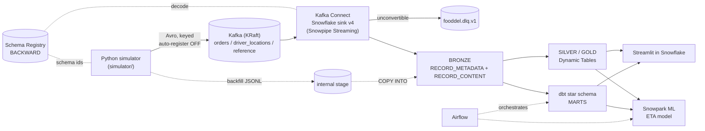
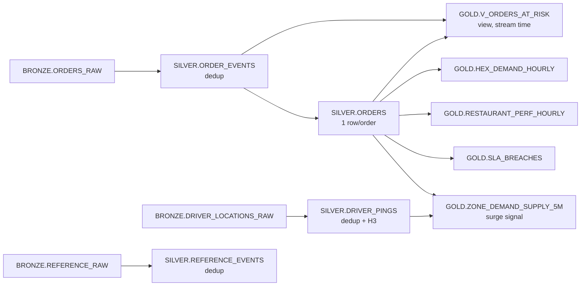
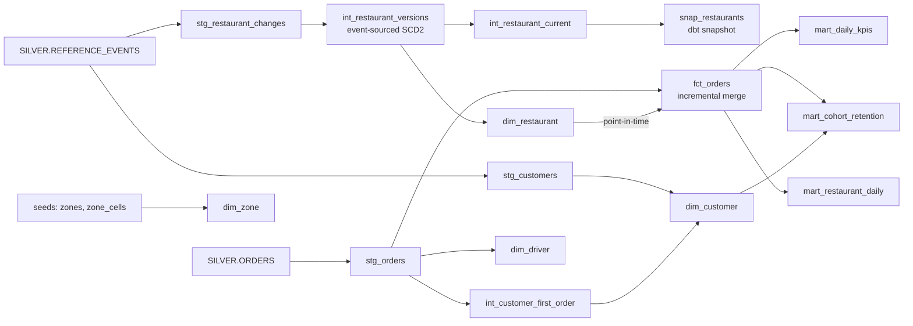
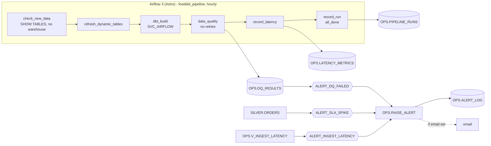
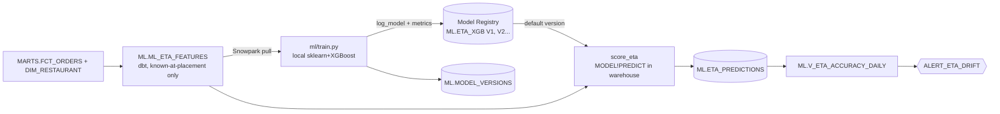
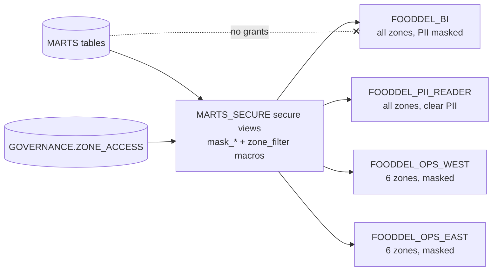

# Architecture

| Phase | Status | Components |
|---|---|---|
| P1 | done | simulator, Makefile, tests |
| P2 | done, verified end-to-end | topics, Schema Registry (Avro), Kafka Connect + Snowflake sink v4, BRONZE DDL, RBAC, backfill COPY |
| P3 | done, reconciled 37/37 | SILVER Dynamic Tables (dedup, typing, order lifecycle), GOLD Dynamic Tables (demand/supply + surge, SLA breaches, restaurant perf, H3 hex demand), at-risk view |
| P4 | done, reconciled 35/35 | dbt star schema on SILVER: fct_orders (incremental), SCD2 dim_restaurant, dim_customer/zone/driver/date, daily KPIs, cohort retention, restaurant daily |
| P5 | done | Airflow 3 DAG (skip-if-no-data, DT refresh, dbt, DQ, latency), OPS schema, 3 Snowflake Alerts, SVC_AIRFLOW |
| P6 | done | ETA model: dbt features, XGBoost pipeline in Snowflake Model Registry, in-warehouse scoring in the DAG, daily MAE + drift alert (test MAE 4.29 vs promised 6.45) |
| P7 | done | Secure-view governance (Standard edition): PII masking + zone row filtering by role, zero-copy clone + Time Travel, cost report |
| P8 | done | Streamlit in Snowflake dashboard (owned by FOODDEL_BI), Terraform environment module (validate-only), GitHub Actions CI, final docs |

## Local stack (`make up`)

| Service | Port | Purpose |
|---|---|---|
| kafka (cp-kafka 7.8.2, KRaft) | 9092 | broker; auto-create OFF |
| kafka-init | - | creates topics + retention, then exits |
| schema-registry | 8081 | 11 Avro subjects, BACKWARD |
| connect (+ Snowflake connector 4.1.0) | 8083 | sink to BRONZE; deployed only by `make connector-up` |
| kafka-ui | 8080 | browse topics (Avro-decoded), schemas, connector |

## Snowflake objects

| Object | Notes |
|---|---|
| `FOODDEL_DEV` | schemas BRONZE / SILVER / GOLD / MARTS |
| `BRONZE.ORDERS_RAW`, `DRIVER_LOCATIONS_RAW`, `REFERENCE_RAW` | VARIANT landing tables, change tracking on |
| `BRONZE.BACKFILL_STAGE`, `FF_JSONL` | internal stage for history |
| `WH_INGEST`, `WH_TRANSFORM`, `WH_BI` | XSMALL, AUTO_SUSPEND=60, resource monitors (5 cr each, 20 account) |
| `FOODDEL_INGEST` / `_TRANSFORM` / `_BI` | functional roles under SYSADMIN |
| `SVC_KAFKA_CONNECTOR` | TYPE=SERVICE, key-pair only |

## Dynamic Tables (P3)

| Layer | Target lag | Refresh mode |
|---|---|---|
| SILVER (ORDER_EVENTS, DRIVER_PINGS, ORDERS) | DOWNSTREAM | INCREMENTAL |
| SILVER.REFERENCE_EVENTS | 10 minutes (no consumers until P4) | INCREMENTAL |
| GOLD | 10 minutes (`make dt-demo` -> 1 minute) | INCREMENTAL |

## dbt historical layer (P4)

Schemas: `STAGING` (stg/int views+tables, snapshot; not visible to BI), `MARTS` (dims, fact, marts, seeds).

## Orchestration, data quality, alerts (P5)

| Local UI | Port |
|---|---|
| Airflow | http://localhost:8082 |
| kafka-ui | http://localhost:8080 |

## ETA model (P6)

## Governance (P7)

## Design rationale
- [ADR 0001: simulator](decisions/0001-simulator-design.md)
- [ADR 0002: Kafka, Schema Registry, Snowflake ingestion](decisions/0002-kafka-schema-registry-snowflake-ingestion.md)
- [ADR 0003: SILVER/GOLD Dynamic Tables](decisions/0003-dynamic-tables-silver-gold.md)
- [ADR 0004: dbt historical layer](decisions/0004-dbt-historical-layer.md)
- [ADR 0005: orchestration, data quality, alerts, latency](decisions/0005-orchestration-dq-alerts-latency.md)
- [ADR 0006: ETA model, Model Registry, MAE tracking](decisions/0006-eta-model-registry-mae.md)
- [ADR 0007: governance and cost](decisions/0007-governance-and-cost.md) · [cost report](cost_report.md)
- [ADR 0008: dashboards, Terraform, CI](decisions/0008-dashboards-terraform-ci.md)
