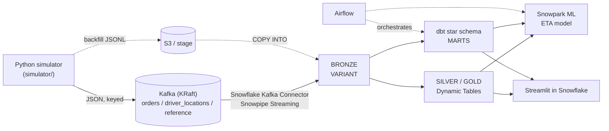

# Architecture

| Phase | Status | Components |
|---|---|---|
| P1 | done | simulator, Kafka docker-compose, Makefile, tests |
| P2-P8 | planned | see CLAUDE.md |

## Event flow (P1)
- Event contract: [`simulator/schemas/`](../simulator/schemas)
- Design rationale: [ADR 0001](decisions/0001-simulator-design.md)
