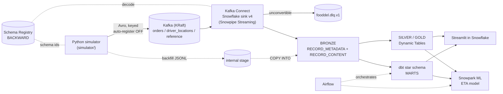

# Architecture

| Phase | Status | Components |
|---|---|---|
| P1 | done | simulator, Makefile, tests |
| P2 | done, verified end-to-end | topics, Schema Registry (Avro), Kafka Connect + Snowflake sink v4, BRONZE DDL, RBAC, backfill COPY |
| P3-P8 | planned | see CLAUDE.md |

## Local stack (`make up`)

| Service | Port | Purpose |
|---|---|---|
| kafka (cp-kafka 7.8.2, KRaft) | 9092 | broker; auto-create OFF |
| kafka-init | - | creates topics + retention, then exits |
| schema-registry | 8081 | 11 Avro subjects, BACKWARD |
| connect (+ Snowflake connector 4.1.0) | 8083 | sink to BRONZE; deployed only by `make connector-up` |
| kafka-ui | 8080 | browse topics (Avro-decoded), schemas, connector |

## Snowflake objects

| Object | Notes |
|---|---|
| `FOODDEL_DEV` | schemas BRONZE / SILVER / GOLD / MARTS |
| `BRONZE.ORDERS_RAW`, `DRIVER_LOCATIONS_RAW`, `REFERENCE_RAW` | VARIANT landing tables, change tracking on |
| `BRONZE.BACKFILL_STAGE`, `FF_JSONL` | internal stage for history |
| `WH_INGEST`, `WH_TRANSFORM`, `WH_BI` | XSMALL, AUTO_SUSPEND=60, resource monitors (5 cr each, 20 account) |
| `FOODDEL_INGEST` / `_TRANSFORM` / `_BI` | functional roles under SYSADMIN |
| `SVC_KAFKA_CONNECTOR` | TYPE=SERVICE, key-pair only |

## Design rationale
- [ADR 0001: simulator](decisions/0001-simulator-design.md)
- [ADR 0002: Kafka, Schema Registry, Snowflake ingestion](decisions/0002-kafka-schema-registry-snowflake-ingestion.md)
